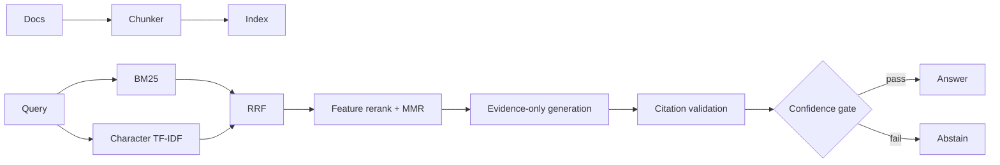

# Veritas RAG

[](https://github.com/AmanRajhans/veritas-rag/actions/workflows/ci.yml)
[](https://www.python.org/)
[](LICENSE)

An evaluation-first retrieval-augmented generation system that returns **grounded answers or an explicit abstention**. Veritas combines BM25, local-semantic character retrieval, weighted reciprocal-rank fusion, transparent reranking, MMR diversity, citation validation, and confidence gating in a deployable FastAPI service.

It runs end to end without an API key. An optional OpenAI-compatible adapter can connect the same grounding contract to a hosted model or local gateway.

## Why this project is more than a RAG demo

- **Hybrid retrieval:** exact-term BM25 plus morphology/typo-tolerant n-gram retrieval.
- **Trust boundary:** evidence-only synthesis, per-sentence citations, validation, and abstention.
- **Evaluation:** Recall@K, MRR, nDCG@K, answer token F1, latency, and abstention rate.
- **Reproducibility:** `uv.lock`, deterministic IDs, versioned tamper-evident JSON artifacts.
- **Production shape:** typed API, index-aware SQLite cache, health/metrics endpoints, Docker, CI.
- **Testability:** deterministic offline baseline; no model download or paid service in the test path.

## Architecture



See [the engineering decision record](docs/architecture.md) for failure modes and production extensions.

## Quick start

Prerequisites: Python 3.11–3.13 and [uv](https://docs.astral.sh/uv/).

```bash
git clone https://github.com/AmanRajhans/veritas-rag.git
cd veritas-rag
uv sync --dev

uv run veritas-rag index data/demo --output artifacts/demo-index.json
uv run veritas-rag ask \
  "When do employees need manager approval for expenses?" \
  --index artifacts/demo-index.json --trace
```

Start the API and open `http://localhost:8000/docs`:

```bash
uv run veritas-rag serve --index artifacts/demo-index.json
```

```bash
curl -s http://localhost:8000/v1/query \
  -H 'content-type: application/json' \
  -d '{"query":"What triggers an automatic rollback?","top_k":5}'
```

## Evaluate, test, and lint

```bash
uv run veritas-rag evaluate data/eval/questions.jsonl \
  --index artifacts/demo-index.json \
  --output artifacts/evaluation.json
uv run pytest
uv run ruff check .
uv run ruff format --check .
uv run mypy
```

The included evaluation set is deliberately small and exists as an executable example, not a benchmark claim. Add real domain questions and calibrate the confidence threshold before production use.

The checked demo run retrieves the labeled section at rank one for all six questions: Recall@5 **1.00**, MRR **1.00**, and nDCG@5 **1.00**. Those values validate the pipeline on the bundled synthetic handbook; they are not a claim about general-domain performance.

## Optional model-backed generation

Any endpoint implementing the common chat-completions request shape can be used:

```bash
cp .env.example .env
export VERITAS_GENERATOR=openai-compatible
export VERITAS_LLM_BASE_URL=http://localhost:11434/v1
export VERITAS_LLM_MODEL=qwen2.5:7b
uv run veritas-rag ask "How long is break-glass access valid?" \
  --index artifacts/demo-index.json
```

The adapter rejects out-of-range citations. For a production LLM, also add claim-level entailment checks and calibrate on human labels.

## API surface

| Endpoint | Purpose |
|---|---|
| `GET /healthz` | Readiness plus index fingerprint and chunk count |
| `POST /v1/retrieve` | Inspect ranked evidence and component scores |
| `POST /v1/query` | Return answer, citations, confidence, abstention, and optional trace |
| `GET /metrics` | Prometheus text-format request/error/latency metrics |

## Docker

```bash
docker build -t veritas-rag .
docker run --rm -p 8000:8000 veritas-rag
```

## Repository map

```text
src/veritas_rag/   retrieval, generation, evaluation, API, and CLI
tests/             unit, integration, API, cache, and tamper tests
data/demo/         synthetic company policies (no proprietary data)
data/eval/         versioned example evaluation set
docs/              architecture and interview notes
```

## Responsible-use note

The confidence score is a routing signal, not a probability that the answer is true. Access-control filters, human review for consequential decisions, domain evaluation, and monitoring remain necessary.

## License

MIT
