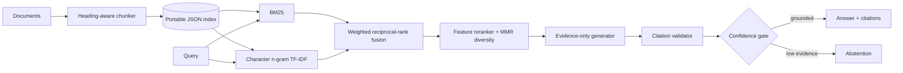

# Architecture and engineering decisions

## Request path

## Why two retrieval signals?

BM25 is strong on exact domain terms and is easy to inspect. Character n-gram TF-IDF catches spelling variation, morphology, IDs, and partial names without requiring a network download. Reciprocal-rank fusion combines the orderings without pretending their raw score scales are comparable. A `sentence-transformers` extra is declared for experiments, while the default path stays deterministic and CI-friendly.

## Grounding contract

The default generator selects complete source sentences and attaches the evidence rank to every sentence. The optional OpenAI-compatible adapter receives the same numbered evidence and is rejected if it emits an out-of-range citation. The confidence gate combines retrieval strength, query-token coverage, and citation count; low-confidence output becomes an explicit abstention.

## Index safety

Artifacts are JSON rather than pickle, so loading an index cannot execute arbitrary Python. A SHA-256 fingerprint covers canonical chunk content and detects accidental or malicious edits. Cache keys include this fingerprint, normalized query, and retrieval depth, preventing stale answers after re-indexing.

## Production extensions

- Replace local semantic retrieval with a vector store and sentence-transformer encoder.
- Learn reranker weights from click or relevance labels.
- Export traces through OpenTelemetry and metrics through a Prometheus client.
- Store raw documents in object storage and enforce document-level ACL filters before fusion.
- Calibrate the confidence threshold on an in-domain labeled set rather than the included demonstration set.
